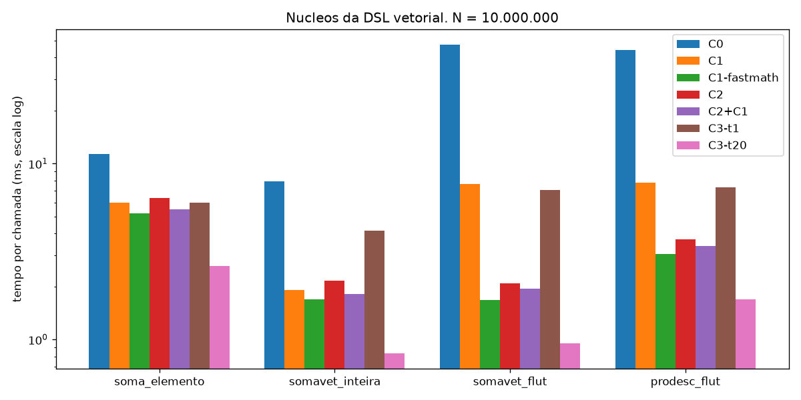
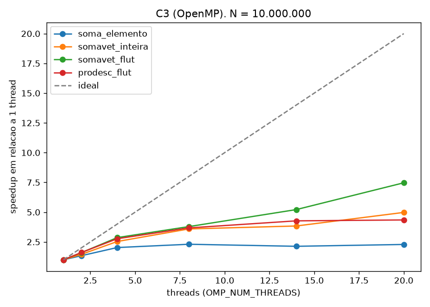

# Relatório de otimização — DSL vetorial, MLIR e desempenho (PjBL 4, Partes B e C)

Tudo aqui é reproduzível com **um comando**: `make bench`, que roda
`scripts/bench/bench.py` (≈ 10 min). Ele regenera as tabelas em
[`bench/resultados.md`](./bench/resultados.md), os gráficos `bench/*.png`, os
relatórios `-Rpass` e o IR otimizado de cada configuração.

## 1. Estratégia de integração: híbrida

O programa continua em LLVM IR (back-end do PjBL 3) e **só as operações
vetoriais** são emitidas em MLIR, como funções independentes ("núcleos"). O
`mlir-opt` e o `mlir-translate` levam os núcleos até LLVM IR, e o `llvm-link`
une os dois módulos.

```text
programa.mac --macaronica--> programa.ll  (programa, com "call @zl_nucleo_N")
                         \--> programa.mlir (func.func @zl_nucleo_N, affine)
programa.mlir --scripts/pipeline.sh (C0|C2|C3)--> programa.nucleos.ll
programa.ll + programa.nucleos.ll --llvm-link--> programa.final.ll --> clang | llc
```

Justificativa:

- O back-end do PjBL 3 já cobre toda a linguagem e está testado (lli, clang,
  AVR). Reescrevê-lo em MLIR não traria ganho para código escalar.
- Os núcleos são exatamente onde o MLIR ajuda: laços afins sobre `memref` de
  forma estática, que o `affine-super-vectorize` e o `affine-parallelize`
  analisam com exatidão (índices são funções afins de `%i`, limites
  constantes).
- Cada comando da DSL vira **um** núcleo com **um** laço, ou seja, a expressão
  é fundida: `c receba a + k * b - c` faz uma passada só, sem vetores
  temporários.
- A fronteira é uma ABI simples e igual em todo alvo: com
  `use-bare-ptr-memref-call-conv=1`, cada vetor vira um `ptr` e cada escalar
  passa por valor. O gerador de LLVM IR chama `@zl_nucleo_N(ptr @a, ptr @b,
  ptr %c)`, e a mesma chamada funciona no x86-64 e no AVR.
- Custo: uma chamada de função por operação vetorial, desprezível com N grande.
  Como o `llvm-link` produz um único módulo, o `-O2` pode embutir o núcleo no
  programa.

A geração está em `src/codegen_mlir.c` (dialetos `func`, `arith`, `memref` e
`affine`). Os dialetos `vector`, `scf` e `omp` aparecem nos níveis seguintes,
criados pelos passes.

## 2. Pipeline (`scripts/pipeline.sh`)

| Passo | C0 (base) | C2 (vetorização) | C3 (paralelismo) |
| --- | --- | --- | --- |
| 1. nível affine | — | `--affine-super-vectorize="virtual-vector-size=8 vectorize-reductions=true"` | `--affine-parallelize="max-nested=1 parallel-reductions=true"` |
| 2. sai do affine | `--lower-affine` | `--lower-affine --convert-vector-to-scf` | `--lower-affine --convert-scf-to-openmp --canonicalize` |
| 3. dialeto llvm | `--convert-scf-to-cf --convert-vector-to-llvm --convert-arith-to-llvm --finalize-memref-to-llvm --convert-func-to-llvm=use-bare-ptr-memref-call-conv=1 --convert-cf-to-llvm --convert-ub-to-llvm --reconcile-unrealized-casts` | idem | idem + `--convert-openmp-to-llvm` |
| 4. LLVM IR | `mlir-translate --mlir-to-llvmir` | idem | idem |

O script tem um comentário explicando cada passo. Todos rodam com
`--mlir-disable-threading` por causa de uma falha do verificador multithread
do `mlir-opt`/`mlir-translate` desta build (MSYS2, MLIR 23.1.5): uma falha de
segmentação intermitente, sem relação com o nosso MLIR, que some com uma só
thread. `--convert-ub-to-llvm` é necessário quando N não é múltiplo de 8: o
vetorizador lê a última volta com preenchimento `ub.poison`
(`tests/dsl/07_tamanho_impar.mac`).

`make test` executa todos os programas de `tests/dsl/` em C0, C2 e C3 e
exige a mesma saída.

**Executor JIT do MLIR** (ferramenta obrigatória do enunciado):
`scripts/jit.sh` leva o módulo final, isto é, o programa e os núcleos já
ligados, de volta ao MLIR com `mlir-translate --import-llvm`. Um envoltório
`@zl_jit_main` chama `@zl_principal`, e o `mlir-runner` compila e executa
tudo no JIT, ligando a biblioteca de execução como biblioteca compartilhada
(`-DZL_SEM_MAIN`; no C3, também a `libomp`):

```sh
sh scripts/jit.sh tests/dsl/04_produto_escalar.mac C2
echo "21 5.5" | sh scripts/jit.sh tests/execucao/17_principal_parametros.mac
```

`make test-jit` (parte do `make test`) roda pelo JIT os 19 programas de
`tests/execucao` (C0) e os 7 da DSL em C2 e C3, com a mesma saída de `lli` e
`clang`.

**Queda intermitente do `mlir-runner` no Windows.** O `mlir-runner` 23.1.5
do MSYS2 cai às vezes (`Exception Code: 0xC0000005`) **antes de executar o
programa**, ao verificar o módulo: o verificador do MLIR roda em várias
threads (`failableParallelForEach`) e quebra em `StorageUniquer`. Medimos 3
quedas em 40 execuções do mesmo programa; a falha aparece de forma aleatória
no `make test`, por isso ele passava em um PC e falhava em outro. O
`mlir-opt` e o `mlir-translate` evitam o problema com
`--mlir-disable-threading`, mas o `mlir-runner` não aceita essa opção. Como a
queda acontece antes de o programa imprimir ou ler qualquer coisa,
`scripts/jit.sh` repete a execução (até 5 vezes) quando a ferramenta cai sem
ter impresso nada. Cada repetição fica registrada em
`<saída>/<programa>.jit.tentativas`, fora da saída comparada pelos testes. O
erro está na ferramenta, não no IR: o mesmo módulo roda sem falhas no `lli` e
no `clang`, e passa no `mlir-translate`/`mlir-opt` com a verificação em uma
thread.

## 3. O mesmo núcleo em três níveis

Programa [`mlir/exemplo.mac`](./mlir/exemplo.mac), com `N = 1024`:
`c receba a + b;` e `somavet(c)`. Arquivos completos em `mlir/niveis_C0/`,
`mlir/niveis_C2/` e `mlir/niveis_C3/`.

### 3.0 Gerado pelo compilador (affine, escalar)

```mlir
func.func @zl_nucleo_2(%v0: memref<1024xf32>) -> f32 attributes {llvm.passthrough = ["nounwind"]} {
  %zero = arith.constant 0.000000e+00 : f32
  %r = affine.for %i = 0 to 1024 iter_args(%acc = %zero) -> (f32) {
    %x0 = affine.load %v0[%i] : memref<1024xf32>
    %n = arith.addf %acc, %x0 : f32
    affine.yield %n : f32
  }
  return %r : f32
}
```

### 3.1 Nível 1: affine vetorizado (C2, `niveis_C2/1-affine.mlir`)

```mlir
%cst_0 = arith.constant dense<0.000000e+00> : vector<8xf32>
%0 = affine.for %arg1 = 0 to 1024 step 8 iter_args(%arg2 = %cst_0) -> (vector<8xf32>) {
  %3 = vector.transfer_read %arg0[%arg1], %2 {in_bounds = [true]} : memref<1024xf32>, vector<8xf32>
  %4 = arith.addf %arg2, %3 : vector<8xf32>
  affine.yield %4 : vector<8xf32>
}
%1 = vector.reduction <add>, %0 : vector<8xf32> into f32
```

**Preservado**: a estrutura do laço, os limites e o fato de os acessos serem
afins. **Mudou**: o laço anda de 8 em 8, o acumulador escalar virou um vetor de
8 somas parciais e um `vector.reduction` final junta as 8 parcelas. **Essa é
uma reassociação da soma de ponto flutuante**: a ordem
`((x0 + x1) + x2) + ...` virou 8 somas intercaladas (`x0 + x8 + x16 + ...`),
feita sem nenhuma permissão `fastmath` (Seção 5).

### 3.2 Nível 2: `scf` + `vector` (`niveis_C2/2-vector-ou-scf.mlir`)

```mlir
%c0 = arith.constant 0 : index
%c1024 = arith.constant 1024 : index
%c8 = arith.constant 8 : index
scf.for %arg3 = %c0 to %c1024 step %c8 {
  %1 = vector.transfer_read %arg0[%arg3], %0 {in_bounds = [true]} : memref<1024xf32>, vector<8xf32>
  %2 = vector.transfer_read %arg1[%arg3], %0 {in_bounds = [true]} : memref<1024xf32>, vector<8xf32>
  %3 = arith.addf %1, %2 : vector<8xf32>
  vector.transfer_write %3, %arg2[%arg3] {in_bounds = [true]} : vector<8xf32>, memref<1024xf32>
}
```

**Descartado**: os mapas afins; os limites viram valores SSA comuns e a
análise de dependências exata do affine não está mais disponível. **Mantido**:
o laço estruturado (`scf.for`), os tipos `vector<8xf32>` e a informação
`in_bounds` (nenhuma leitura sai do vetor).

### 3.3 Nível 3: dialeto `llvm` (`niveis_C2/3-llvm.mlir`)

```mlir
llvm.func @zl_nucleo_2(%arg0: !llvm.ptr) -> f32 attributes {passthrough = ["nounwind"]} {
  %0 = llvm.mlir.poison : !llvm.struct<(ptr, ptr, i64, array<1 x i64>, array<1 x i64>)>
  %1 = llvm.insertvalue %arg0, %0[0] : !llvm.struct<(ptr, ptr, i64, array<1 x i64>, array<1 x i64>)>
  ...                                             // tamanho 1024 e passo 1 no descritor
  %9 = llvm.mlir.constant(dense<0.000000e+00> : vector<8xf32>) : vector<8xf32>
  llvm.br ^bb1(%10, %9 : i64, vector<8xf32>)
^bb1(%13: i64, %14: vector<8xf32>):  // 2 preds: ^bb0, ^bb2
  %15 = llvm.icmp "slt" %13, %11 : i64
  llvm.cond_br %15, ^bb2, ^bb3
^bb2:  // pred: ^bb1
  %16 = llvm.extractvalue %8[1] : !llvm.struct<(ptr, ptr, i64, array<1 x i64>, array<1 x i64>)>
  %17 = llvm.getelementptr %16[%13] : (!llvm.ptr, i64) -> !llvm.ptr, f32
  %18 = llvm.load %17 {alignment = 4 : i64} : !llvm.ptr -> vector<8xf32>
  %19 = llvm.fadd %14, %18 : vector<8xf32>
  %20 = llvm.add %13, %12 : i64
  llvm.br ^bb1(%20, %19 : i64, vector<8xf32>)
^bb3:  // pred: ^bb1
  %22 = "llvm.intr.vector.reduce.fadd"(%21, %14) <{fastmathFlags = #llvm.fastmath<none>}> : (f32, vector<8xf32>) -> f32
  llvm.return %22 : f32
}
```

**Descartado**: o tipo `memref`. Cada vetor virou o descritor
`{ptr alocado, ptr alinhado, deslocamento, [tamanho], [passo]}`, montado com
`insertvalue` a partir do ponteiro simples da ABI. A forma (1024 elementos)
continua só como constante; o laço virou blocos com `llvm.br`/`llvm.cond_br`;
`vector.reduction` virou `llvm.intr.vector.reduce.fadd`. O `-O2` do LLVM depois
elimina a montagem do descritor (é tudo constante).

### 3.4 C3: OpenMP (`niveis_C3/2-vector-ou-scf.mlir`)

```mlir
omp.parallel {
  omp.wsloop reduction(@__scf_reduction %1 -> %arg1 : !llvm.ptr) {
    omp.loop_nest (%arg2) : index = (%c0) to (%c1024) step (%c1) {
      %4 = memref.load %arg0[%arg2] : memref<1024xf32>
      %5 = llvm.load %arg1 : !llvm.ptr -> f32
      %6 = arith.addf %5, %4 : f32
      llvm.store %6, %arg1 : f32, !llvm.ptr
```

O `affine.for` com `iter_args` virou um `affine.parallel` com redução, e depois
um `omp.wsloop` com uma redução declarada (`@__scf_reduction`). Cada thread
acumula em uma cópia privada do acumulador, **lida e escrita na memória a cada
iteração** (`llvm.load`/`llvm.store`), e as cópias são combinadas no fim. Isso
explica por que o C3 com 1 thread é mais lento que o C1 (Seção 8).

## 4. Estudo experimental (Parte C)

### 4.1 Metodologia

| Item | Valor |
| --- | --- |
| Máquina | Intel Core i9-12900H (Alder Lake): 6 núcleos P + 8 núcleos E, 20 threads; AVX2 + FMA, sem AVX-512; 32 GB DDR5 |
| Sistema | Windows 11, MSYS2 UCRT64; clang/LLVM/MLIR 23.1.5 |
| Núcleos | 4, gerados pelo compilador a partir de um `nucleos.mac` que o `bench.py` escreve em `build/bench/n<N>/` (um por tamanho): **soma elemento a elemento** `c receba a + b` (flut), **redução** `somavet` de `inteira` e de `flut`, **produto escalar** `prodesc` (flut) |
| Tamanhos | N = 10⁶ (12 MB nos três vetores, cabe nos 24 MB de L3) e N = 10⁷ (120 MB, só na RAM) |
| Medida | `scripts/bench/harness.c` chama cada núcleo 40 (10⁶) ou 8 (10⁷) vezes; tempo por chamada; **mediana de 5 execuções** |
| Compilação | tempo de `pipeline.sh` + `clang` medido à parte, também mediana de 5 |
| Flags comuns | `-O2 -march=native` (exceto C0: `-O0`) |

| Configuração | Pipeline MLIR | clang |
| --- | --- | --- |
| C0 | C0 | `-O0` |
| C1 | C0 | `-O2 -march=native` (vetorizador do LLVM) |
| C1-fastmath | C0, núcleos gerados com `--fastmath` | `-O2 -march=native` |
| C2 | C2 | `-O2 -march=native -fno-vectorize -fno-slp-vectorize` (só o MLIR vetoriza) |
| C2+C1 | C2 | `-O2 -march=native` (os dois vetorizadores) |
| C3-tT | C3 | `-O2 -march=native -fno-vectorize -fno-slp-vectorize -fopenmp`, `OMP_NUM_THREADS=T`, T ∈ {1, 2, 4, 8, 14, 20} |

### 4.2 Resultados (tempo por chamada; aceleração em relação a C0)

**N = 10⁷** (ver [`bench/resultados.md`](./bench/resultados.md) para N = 10⁶):

| Configuração | soma elemento | somavet inteira | somavet flut | prodesc flut | compilação |
| --- | ---: | ---: | ---: | ---: | ---: |
| C0 | 11,33 ms (1,0×) | 7,91 ms (1,0×) | 47,51 ms (1,0×) | 44,27 ms (1,0×) | 2,11 s |
| C1 | 5,99 ms (1,9×) | 1,90 ms (4,2×) | 7,63 ms (6,2×) | 7,79 ms (5,7×) | 2,12 s |
| C1-fastmath | 5,19 ms (2,2×) | 1,69 ms (4,7×) | 1,67 ms (28,4×) | 3,07 ms (14,4×) | 2,11 s |
| C2 | 6,36 ms (1,8×) | 2,16 ms (3,7×) | 2,08 ms (22,8×) | 3,72 ms (11,9×) | 2,90 s |
| C2+C1 | 5,47 ms (2,1×) | 1,82 ms (4,4×) | 1,95 ms (24,4×) | 3,40 ms (13,0×) | 2,76 s |
| C3-t1 | 6,00 ms (1,9×) | 4,15 ms (1,9×) | 7,09 ms (6,7×) | 7,33 ms (6,0×) | 2,76 s |
| C3-t20 | 2,62 ms (4,3×) | 0,83 ms (9,5×) | 0,95 ms (50,0×) | 1,69 ms (26,2×) | 2,70 s |





A compilação leva de 2 a 3 s em todas as configurações. Quase todo esse tempo é
partida de processo no Windows (`sh`, 3 a 4 `mlir-opt`, `mlir-translate`,
`clang`), não otimização: C2 e C3 custam ~0,7 s a mais por terem mais passes.

## 5. Pergunta obrigatória: por que a redução de ponto flutuante não vetoriza?

**Resposta.** Vetorizar uma redução significa trocar a ordem das somas: em
vez de `((x0 + x1) + x2) + ...`, o vetor de 8 posições soma
`x0 + x8 + x16 + ...` em uma posição, `x1 + x9 + ...` em outra, e no fim junta
as 8 parcelas. Para **inteiros** isso não muda nada: a soma em complemento de
dois é associativa (mesmo com estouro, o resultado módulo 2³² é o mesmo em
qualquer ordem). Em **ponto flutuante** não: cada soma arredonda para o float
mais próximo, e `(a + b) + c ≠ a + (b + c)` em geral, então outra ordem dá
outro resultado. A semântica da linguagem (e do LLVM IR sem flags) é a ordem
do programa; o vetorizador só pode reordenar se a instrução disser que pode
(`fadd reassoc`/`fast`), o que o `-ffast-math` faz em código C.

**Evidência 1: relatório do vetorizador** (`bench/rpass_C1.txt`, C1):

```text
remark: vectorized loop (vectorization width: 8, interleaved count: 4)  [2x: soma elemento e somavet inteira]
remark: loop not vectorized: cannot prove it is safe to reorder floating-point
        operations; allow reordering ... or by providing the compiler option
        '-ffast-math'                                                       [2x: somavet flut e prodesc]
```

**Evidência 2: instruções vetoriais no IR otimizado** (contagem de
`<N x i32>`/`<N x float>`, `bench/ir_*.ll`):

| Configuração | soma elemento | somavet inteira | somavet flut | prodesc flut |
| --- | ---: | ---: | ---: | ---: |
| C1 | 32 | 48 | **0** | **0** |
| C1-fastmath | 32 | 48 | **48** | **40** |

No C1 a redução de `flut` fica escalar (`%7 = fadd float %3, %6`, em cadeia).
No C1-fastmath, com `fadd fast`, ela vira 4 acumuladores `<8 x float>`:

```llvm
vector.body:
  %vec.phi = phi <8 x float> [ zeroinitializer, %vector.ph ], [ %41, %vector.body ]
  %vec.phi1 = phi <8 x float> [ zeroinitializer, %vector.ph ], [ %42, %vector.body ]
```

**Evidência 3: o resultado numérico muda** (soma exata calculada com
`math.fsum` sobre os mesmos floats):

| N = 10⁶ | somavet flut | erro relativo |
| --- | ---: | ---: |
| exato | 3 404 697 142,76 | — |
| C0 / C1 (ordem do programa) | 3 389 031 936 | −0,46 % |
| C1-fastmath (32 somas parciais) | 3 404 699 136 | +0,00006 % |
| C2 (8 somas parciais, MLIR) | 3 404 587 776 | −0,0032 % |

| N = 10⁷ | somavet flut | erro relativo |
| --- | ---: | ---: |
| exato | 34 046 911 427,61 | — |
| C0 / C1 | 34 095 747 072 | +0,14 % |
| C1-fastmath | 34 039 910 400 | −0,021 % |
| C2 | 33 840 031 744 | **−0,61 %** |

**Evidência 4: o ganho.** Com permissão de reassociar, `somavet flut` passa de
6,2× (só otimização escalar) para **28,4×** em N = 10⁷.

Nenhuma ordem é "a correta": em N = 10⁶ as ordens reassociadas erraram menos
que a sequencial; em N = 10⁷ a do MLIR (C2) errou **mais**. Por isso o
compilador não pode escolher a ordem sozinho: a soma inteira, ao contrário,
deu exatamente o mesmo resultado (−11446 e −14698) em **todas** as
configurações.

**Achado.** `clang -ffast-math` sobre um `.ll` não tem efeito: a permissão de
reassociar fica em cada instrução do IR, e o `clang` não reescreve instruções
de um IR já pronto. Na primeira rodada, o C1-fastmath com `-ffast-math` ficou
idêntico ao C1 (0 instruções vetoriais). A permissão tem que vir do gerador:
`macaronica --fastmath` emite `arith.addf ... fastmath<fast>` nos núcleos, que
vira `fadd fast` no LLVM IR.

## 6. C1 × C2: o que cada vetorizador fez

| | Vetorizador do LLVM (C1) | Vetorizador do MLIR (C2) |
| --- | --- | --- |
| Soma elemento a elemento | vetoriza: largura 8, intercalação 4 (32 elementos por volta) | vetoriza: largura 8, sem intercalação |
| Redução de inteiros | vetoriza (largura 8 × 4) | vetoriza (largura 8, `vector.reduction`) |
| Redução de `flut` | **recusa** sem `reassoc` (preserva a semântica IEEE) | **vetoriza** sem pedir permissão (muda o resultado) |
| Resto (N não múltiplo de 8) | laço de resto escalar | leitura mascarada (`ub.poison`) na última volta |
| Escolha da largura | modelo de custo do alvo (`-march=native`) | fixa (`virtual-vector-size=8`), independe do alvo |
| Precisa de target triple | **sim**: `opt -O2` sem triple produz **0** instruções vetoriais; com `-mtriple=x86_64-w64-windows-gnu -mcpu=native`, **80** | não: decide no nível affine |

Em desempenho, os dois empatam onde ambos vetorizam (soma elemento e redução
inteira: diferença ≤ 15 %, a favor do LLVM pela intercalação 4×). O MLIR
"ganha" nas reduções de `flut` (22,8× contra 6,2× do C1), mas porque reassocia
sem permissão. Com a mesma permissão (C1-fastmath), o resultado **depende do
tamanho**:

- em N = 10⁷ o LLVM vence: 28,4× contra 22,8× em `somavet flut` e 14,4×
  contra 11,9× em `prodesc`. Ele usa 4 acumuladores em vez de 1, o que
  esconde a latência da soma de ponto flutuante;
- em N = 10⁶ (dados no L3) o MLIR vence: 57,2× contra 37,6× e 29,6× contra
  17,6×.

Não há um vencedor geral; as duas abordagens ficam na mesma ordem de grandeza.
Juntar os dois (C2+C1) dá o melhor tempo em N = 10⁶ (63,9× e 35,2×), mas em
N = 10⁷ fica entre os dois: o LLVM não revetoriza o que já vem vetorizado e só
intercala o laço.

## 7. C3: paralelismo e escalabilidade

- **N = 10⁷, reduções**: escalam até 20 threads: `somavet flut` 7,09 → 0,95 ms
  (7,5× sobre 1 thread); `somavet inteira`, 5,0×; `prodesc`, 4,4×.
- **N = 10⁷, soma elemento a elemento**: satura em ~2,3× sobre 1 thread
  (5,998 → 2,958 ms com 4 threads, 2,0×; 2,604 ms com 8, 2,3×; 2,623 ms com
  20). Cada chamada move 120 MB (lê `a` e `b`, escreve `c`); a 2,62 ms isso
  dá ≈ 46 GB/s, perto da banda prática da DDR5 do notebook. O laço é **limitado
  pela memória**, não pelo processador: mais threads não trazem mais bytes por
  segundo. As reduções leem menos bytes por operação (uma ou duas leituras e
  nenhuma escrita) e escalam mais.
- **Longe do ideal**: o i9-12900H tem 6 núcleos P e 8 núcleos E, mais lentos.
  O `omp.wsloop` divide as iterações em partes iguais, então as threads nos
  núcleos E terminam por último e seguram a junção.
- **N = 10⁶**: o melhor é 4 threads (soma elemento 6,1×, `somavet flut`
  20,4× sobre C0); com mais threads o tempo **piora**. Cada chamada leva
  ~0,2 ms, e o custo de criar e juntar 14-20 threads (`__kmpc_fork_call`) passa
  a ser comparável ao trabalho de cada uma (50 mil elementos por thread).
- **O resultado de `somavet flut` muda com o número de threads**
  (3 389 031 936 com 1 thread; 3 404 668 160 com 20). Cada thread soma sua
  fatia e as parciais são juntadas no fim: a mesma reassociação da Seção 5, que
  o `parallel-reductions=true` aceita sem `fastmath`. Já o resultado inteiro é
  idêntico em todas as configurações.

## 8. Resultados inesperados (e explicação)

| Observação | Explicação |
| --- | --- |
| `-ffast-math` no clang não mudou nada | A permissão está nas instruções do IR, não na linha de comando (Seção 5) |
| C3 com 1 thread é **2× mais lento** que o C1 na soma inteira (4,15 contra 1,90 ms) | No C3 o LLVM não vetoriza (`-fno-vectorize`, para isolar o efeito do paralelismo), e a redução OpenMP guarda o acumulador em memória (`llvm.load`/`llvm.store` a cada iteração, Seção 3.4) |
| C1-fastmath mais lento que C1 em N = 10⁶ na soma elemento (0,46 contra 0,33 ms) e na `somavet inteira` (0,105 contra 0,074 ms) | Variação de medida. Comparando `bench/ir_C1.ll` e `bench/ir_C1-fastmath.ll` depois do `-O2`, o núcleo inteiro (`zl_nucleo_2`) é **idêntico**, porque `fastmath` não se aplica a inteiros. Na soma elemento só mudam a flag `fast` nos `fadd` e a ordem dos operandos, com as mesmas instruções. Tempos de 0,07 a 0,3 ms estão no limite do turbo e do agendamento entre núcleos P e E do notebook. Em N = 10⁷ a ordem se inverte: 5,19 contra 5,99 ms e 1,69 contra 1,90 ms |
| C2 errou mais que a ordem sequencial em N = 10⁷ | Cada ordem acumula os arredondamentos de um jeito; com estes dados, as 8 parciais de ~4,2·10⁹ (espaçamento do `float` = 256) erraram mais que a soma única. Não existe ordem sempre melhor, e é exatamente por isso que a escolha não pode ser silenciosa |
| C0 → C1 já dá 6× na redução de `flut` sem vetorizar | O IR que vem do MLIR já está em SSA, mas o `-O0` usa o alocador de registradores rápido, que guarda os valores na pilha entre blocos, e refaz a montagem do descritor de memref; o `-O2` deixa o laço com o acumulador em registrador |
| Falha intermitente do `mlir-opt`/`mlir-translate` | Verificador multithread desta build; `--mlir-disable-threading` resolve |
| `affine-parallelize` gera `affine.parallel` inválido para `arith.maxsi` | Falha do MLIR 23 com reduções de máximo/mínimo; o gerador emite máximo e mínimo como `cmp` + `select` (comentário em `mlir_add_reduction`, `src/codegen_mlir.c`) |

## 9. Conclusões

1. A estratégia híbrida isolou o que se beneficia do MLIR com pouco código: um
   gerador de ~700 linhas e um script de pipeline de 4 passos.
2. Para laços limitados pela memória (soma elemento a elemento), vetorizar
   (C1/C2) dá ~2× e paralelizar (C3) mais ~2×; o teto é a banda da memória.
3. Para reduções, o gargalo é a dependência entre somas. Vetorizar e
   paralelizar dão até 28× (vetor) e 50× (20 threads) sobre C0, mas **em ponto
   flutuante isso só é legítimo com permissão para reassociar**, porque o
   resultado muda. O LLVM respeita isso; o vetorizador e o paralelizador do
   MLIR, nesta versão, não.
4. O mesmo `.ll` com núcleos vetorizados roda no Arduino Uno
   (`tests/placa/04_dsl_e_duplo.mac`), onde o `<8 x float>` é legalizado em
   operações escalares: correto, mas sem ganho, já que o AVR não tem SIMD.
